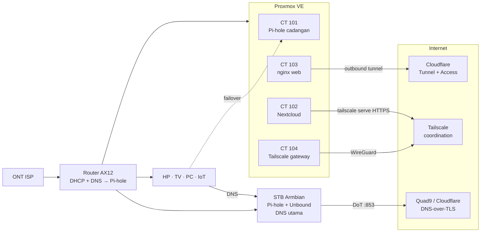

# 🏠 Homelab: DNS Filtering, Self-Hosting & Zero-Trust Remote Access

Homelab rumahan yang saya bangun dari nol, langkah demi langkah, dengan prinsip **manual dulu, paham dulu, baru otomasi**. Proyek ini dimulai dari Pi-hole di Raspberry Pi untuk memblokir iklan dan situs judi online (judol) di seluruh jaringan rumah, lalu berkembang menjadi server Proxmox dengan beberapa layanan yang terisolasi, cloud pribadi, website publik, dan akses jarak jauh tanpa membuka satu port pun di router.

> Semua langkah dikerjakan sendiri di perangkat nyata, diuji dengan bukti (output perintah, header HTTP, log), dan didokumentasikan dalam runbook.

---

## ✨ Hasil akhir

| Kemampuan | Cara kerjanya |
|---|---|
| Iklan, pelacak, telemetri, dan **judol** terblokir di semua perangkat rumah (HP, TV, PC, IoT) | Pi-hole sebagai DNS sinkhole + blocklist + regex, dibagikan otomatis lewat DHCP router |
| DNS terenkripsi, tidak bisa dibajak ISP | Unbound sebagai resolver lokal, meneruskan lewat **DNS-over-TLS** ke Quad9 & Cloudflare Security |
| DNS tetap jalan walau satu server mati | Dua Pi-hole (STB Armbian + kontainer Proxmox), failover **teruji** |
| Cloud pribadi untuk foto & file keluarga | Nextcloud di LXC, instalasi manual (Apache, PHP, MariaDB, Redis, APCu) |
| Website publik tanpa port forwarding | nginx di balik **Cloudflare Tunnel**, halaman pribadi dijaga **Cloudflare Access** (OTP email) |
| Akses Proxmox, Pi-hole, Nextcloud dari mana saja | **Tailscale** subnet router + split DNS, HTTPS resmi untuk Nextcloud via `tailscale serve` |
| Akses dibatasi per perangkat | **ACL Tailscale** (tag + grants) dengan **tests** otomatis: perangkat kantor hanya boleh ke Nextcloud |
| Setiap layanan bisa dipulihkan | Backup harian Proxmox, snapshot sebelum setiap langkah berisiko, **uji restore** sungguhan, salinan backup terverifikasi checksum di media kedua |

## 🧱 Stack

`Proxmox VE 9` · `Debian 13 (LXC)` · `Armbian` · `Pi-hole v6` · `Unbound` · `Nextcloud` · `Apache` · `MariaDB` · `Redis` · `nginx` · `Cloudflare Tunnel` · `Cloudflare Access` · `Tailscale` · `WireGuard` · `Proxmox Firewall` · `UFW`

## 🖥️ Perangkat keras

| Perangkat | Peran |
|---|---|
| Lenovo ThinkCentre M710q Tiny (i5-7500T, 16 GB RAM, SSD 512 GB) | Host Proxmox VE |
| STB HG680P (Amlogic S905X, 2 GB RAM) di-flash Armbian | DNS utama (Pi-hole + Unbound) |
| TP-Link Archer AX12 + node EasyMesh | Router utama, DHCP |
| Raspberry Pi 4 | Platform awal Pi-hole (sudah dipensiunkan dan dikembalikan bersih) |

## 🗺️ Arsitektur singkat

Penjelasan lengkap: [`docs/arsitektur.md`](docs/arsitektur.md)

## 📚 Dokumentasi

| Dokumen | Isi |
|---|---|
| [`docs/arsitektur.md`](docs/arsitektur.md) | Desain jaringan, alur DNS, alur akses dari luar, keputusan desain |
| [`docs/perjalanan.md`](docs/perjalanan.md) | Tahapan proyek dari Raspberry Pi sampai Tailscale, apa yang dikerjakan dan diuji di setiap tahap |
| [`docs/pelajaran.md`](docs/pelajaran.md) | Masalah nyata yang saya temui, penyebabnya, dan cara memperbaikinya |
| [`docs/tailscale-policy.example.hujson`](docs/tailscale-policy.example.hujson) | Contoh policy Tailscale yang dipakai (disanitasi) |

## 🔐 Prinsip keamanan yang diterapkan

- **Tidak ada port terbuka** di router. Akses publik lewat terowongan keluar (Cloudflare), akses pribadi lewat WireGuard (Tailscale).
- **Least privilege**: semua kontainer *unprivileged*; kontainer yang menghadap internet diblokir firewall agar tidak bisa menjangkau LAN; perangkat di VPN hanya mendapat akses yang memang dibutuhkan (ACL berbasis tag).
- **Policy-as-code dengan tes**: aturan akses VPN disimpan sebagai file dan diuji otomatis setiap kali diubah.
- **SSH hanya dengan kunci**, password login dimatikan.
- **Firewall per layanan** (Proxmox Firewall untuk LXC, UFW untuk STB), hanya mengizinkan LAN.
- **Verifikasi sebelum percaya**: checksum image/installer dicek, skrip installer dibaca dulu sebelum dijalankan.
- **Header keamanan**: HSTS, versi server disembunyikan (`server_tokens off`, `ServerTokens Prod`).
- **Data pribadi tidak ikut pergi**: perangkat pinjaman dikembalikan setelah kartu memorinya ditulis ulang.

## 🧠 Yang saya pelajari

- Cara kerja DNS dari ujung ke ujung: resolver, upstream, DNSSEC, DNS-over-TLS, split DNS, dan bagaimana ISP bisa membajak DNS.
- Virtualisasi dengan Proxmox: LXC vs VM, unprivileged container, mount point, snapshot vs backup, thin provisioning.
- Membangun aplikasi web multi-komponen secara manual dan memahami peran setiap bagiannya (web server, PHP, database, cache, cron).
- Reverse proxy dan header terkait: `X-Forwarded-For`, `CF-Connecting-IP`, trusted proxy, HSTS.
- Model **zero-trust**: identitas sebagai pintu (Cloudflare Access), jaringan overlay terenkripsi (Tailscale).
- Kebiasaan operasional: satu perubahan dalam satu waktu, snapshot sebelum langkah berisiko, checkpoint dengan bukti, dan dokumentasi runbook.

## 🚧 Rencana berikutnya

- [x] ACL Tailscale (perangkat tertentu hanya boleh ke Nextcloud)
- [ ] Storage tambahan (NVMe / HDD 6 TB) untuk data Nextcloud
- [ ] SMTP untuk notifikasi Nextcloud
- [ ] Otomasi sinkronisasi dua Pi-hole
- [ ] Infrastructure as Code / Ansible setelah semua langkah manual dipahami

---

*Catatan: alamat IP di dokumentasi ini adalah alamat jaringan lokal (privat). Nama domain, nama tailnet, akun, token, dan password sengaja tidak dicantumkan.*
