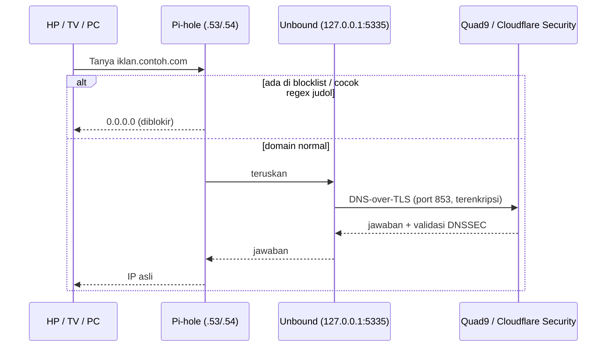

# Arsitektur

## 1. Topologi jaringan

```
Internet
   │
ONT ISP (192.168.1.1)  ← membajak DNS port 53 (dibuktikan dengan forcesafesearch)
   │
Router TP-Link AX12 (192.168.0.1) ── node EasyMesh
   │   DHCP pool   : .100 – .249
   │   Zona statis : .2 – .99
   │   DNS dibagikan: .53 (utama), .54 (cadangan)
   │   IPv6        : OFF (agar DNS tidak lolos lewat IPv6)
   │
   ├── STB Armbian      192.168.0.53  Pi-hole + Unbound (DNS utama)
   ├── Proxmox VE       192.168.0.10
   │     ├── CT 100     192.168.0.11  kontainer latihan
   │     ├── CT 101     192.168.0.54  Pi-hole + Unbound (DNS cadangan)
   │     ├── CT 102     192.168.0.12  Nextcloud
   │     ├── CT 103     192.168.0.13  nginx (situs publik)
   │     └── CT 104     192.168.0.14  Tailscale subnet router
   └── Klien DHCP: HP, Smart TV, PC, IoT
```

**Konvensi penomoran:** CT ID `10x` → IP `192.168.0.1x`. Server DNS memakai `.53`/`.54` supaya mudah diingat (port DNS = 53). Semua perangkat punya nama `*.home.arpa` yang dicatat sebagai Local DNS di Pi-hole.

## 2. Alur DNS (blokir iklan & judol)



Lapisan pemblokiran:

1. **Blocklist** iklan, pelacak, telemetri, dan judi (±1,3 juta domain).
2. **Regex** untuk pola nama domain judol yang terus berganti (misalnya kombinasi kata kunci slot/gacor/toto dengan angka).
3. **Anti-bypass**: domain DNS-over-HTTPS publik diblokir, kanari Firefox `use-application-dns.net` dijawab `NXDOMAIN`, iCloud Private Relay (`mask.icloud.com`) dimatikan, IPv6 dimatikan di router.
4. **Upstream resolver** dengan filter malware (Quad9, Cloudflare Security) sebagai lapisan terakhir.

### Redundansi

Router membagikan dua server DNS. Kalau STB mati, perangkat otomatis memakai CT 101. Konfigurasi disinkronkan satu arah (STB → CT 101) lewat **Teleporter** Pi-hole. Host Proxmox sendiri juga memakai keduanya, sehingga kontainer tidak kehilangan DNS saat STB mati.

## 3. Alur akses dari luar rumah

Dua jalur dengan tujuan berbeda, dan **keduanya tidak membuka port di router**.

### Jalur publik: Cloudflare Tunnel (untuk situs yang memang untuk umum)

```
Pengunjung → https://proyek1.<domain> → Cloudflare edge (TLS, WAF)
          → terowongan KELUAR yang dibuka cloudflared di CT 103 → nginx :80
```

- `cloudflared` di CT 103 yang memulai koneksi keluar; router tidak perlu port forwarding.
- Halaman `pribadi.<domain>` dijaga **Cloudflare Access**: pengunjung harus lolos login One-Time PIN email, dan pemeriksaannya terjadi di Cloudflare sebelum lalu lintas menyentuh server rumah.
- nginx membaca `CF-Connecting-IP` agar log berisi IP asli pengunjung, bukan `127.0.0.1`.
- Firewall keluar CT 103: hanya boleh DNS ke Pi-hole, **semua akses lain ke LAN diblokir**. Kalau situs ini dibobol, penyerang tidak bisa melompat ke perangkat rumah.

### Jalur pribadi: Tailscale (untuk admin & keluarga)

```
HP (data seluler) ══WireGuard══► CT 104 ts-gateway ──► 192.168.0.0/24
HP ══WireGuard══► https://nextcloud.<tailnet>.ts.net ──► CT 102 (tailscale serve → Apache :80)
```

- **Subnet router** (CT 104) mengiklankan `192.168.0.0/24` ke tailnet, sehingga Proxmox, Pi-hole, dan Nextcloud bisa dibuka dengan alamat LAN biasa dari mana saja.
- **Split DNS**: hanya nama `*.home.arpa` yang ditanyakan ke Pi-hole rumah lewat terowongan; DNS lain tetap memakai jaringan setempat.
- **HTTPS resmi** untuk Nextcloud: CT 102 bergabung langsung ke tailnet dan memakai `tailscale serve`, yang mengambil sertifikat Let's Encrypt untuk nama `ts.net` dan meneruskan ke Apache lokal.
- Nextcloud dikonfigurasi dengan `trusted_proxies` + `overwritecondaddr` agar hanya permintaan dari proxy lokal yang dianggap HTTPS. Akses LAN lewat `http://nextcloud.home.arpa` tetap berfungsi.

### Kontrol akses di dalam VPN (ACL Tailscale)

Masuk ke tailnet tidak otomatis berarti boleh ke mana saja. Aturannya ditulis sebagai *grants* (default: tolak semua):

| Perangkat | Identitas | Boleh ke |
|---|---|---|
| Laptop & ponsel pribadi | `autogroup:member` (tanpa tag) | Semua, termasuk LAN rumah lewat subnet router |
| PC kantor | `tag:kantor` | Hanya Nextcloud HTTPS (`tag:nextcloud`, `tcp:443`) |
| Server (gateway, Nextcloud) | `tag:gateway`, `tag:nextcloud` | Tidak memulai koneksi |

- Semua perangkat login dengan akun yang sama, jadi pembeda akses memakai **tag**, bukan akun.
- `autoApprovers` menyetujui rute LAN dari `tag:gateway` secara otomatis.
- Bagian `tests` memastikan PC kantor **tidak** bisa ke Proxmox, DNS, atau SSH server; perubahan policy yang melanggar ditolak saat disimpan.
- Contoh file: [`tailscale-policy.example.hujson`](tailscale-policy.example.hujson)

## 4. Komponen di setiap kontainer

| CT | Layanan | Komponen | Firewall masuk |
|---|---|---|---|
| 101 | DNS cadangan | Pi-hole v6, Unbound | SSH, DNS, HTTP, HTTPS dari LAN |
| 102 | Cloud pribadi | Apache, PHP, MariaDB, Redis, APCu, Nextcloud, Tailscale | SSH, HTTP dari LAN |
| 103 | Situs publik | nginx, cloudflared | SSH, HTTP dari LAN (+ blokir keluar ke LAN) |
| 104 | Gerbang VPN | Tailscale (subnet router, IP forwarding) | SSH dari LAN |

Semua kontainer: template Debian 13, **unprivileged**, zona waktu mengikuti host, login SSH dengan kunci, ikut backup harian.

## 5. Keputusan desain

| Keputusan | Alternatif | Alasan memilih |
|---|---|---|
| LXC + instalasi manual Nextcloud | VM + Docker (All-in-One) | Lebih ringan, dan setiap komponen benar-benar dipahami |
| Tailscale untuk Nextcloud | Membuka Nextcloud ke publik lewat Cloudflare | Tidak ada pintu ke internet; batas ukuran unggahan di paket gratis tunnel |
| Tag per perangkat di Tailscale | Aturan per akun | Semua perangkat memakai satu akun; tag memisahkan perangkat pribadi dan non-pribadi |
| Cloudflare Tunnel untuk situs publik | Port forwarding 80/443 | IP rumah tersembunyi, tanpa port terbuka, TLS & WAF gratis |
| Dua Pi-hole di perangkat fisik berbeda | Satu Pi-hole | Menghapus *single point of failure* DNS rumah |
| Unbound + DoT | DNS ISP / DNS polos | ISP terbukti membajak port 53; DoT tidak bisa dibaca atau diubah di jalan |
| Firewall Proxmox untuk LXC | UFW di dalam kontainer | UFW tidak andal di kontainer unprivileged |
| Data Nextcloud di disk virtual terpisah (`/data`) | Satu disk dengan sistem | Bisa dipindah ke disk lain (Move Volume) tanpa instal ulang |
